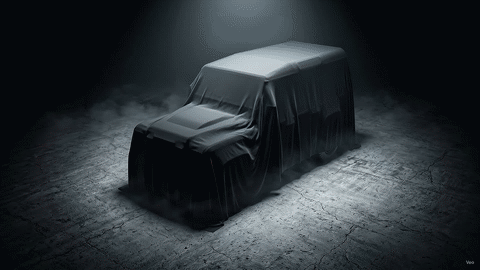
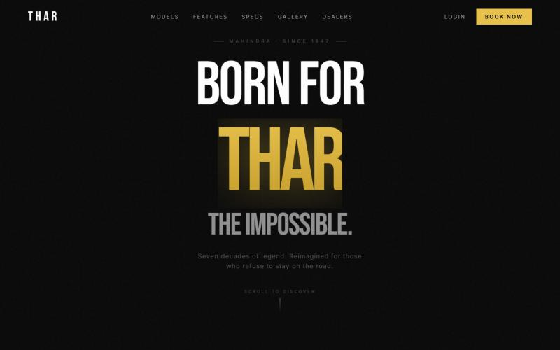
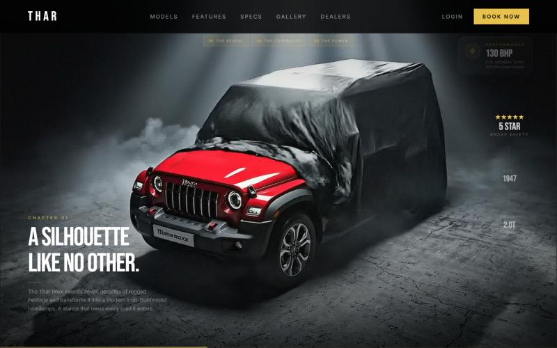
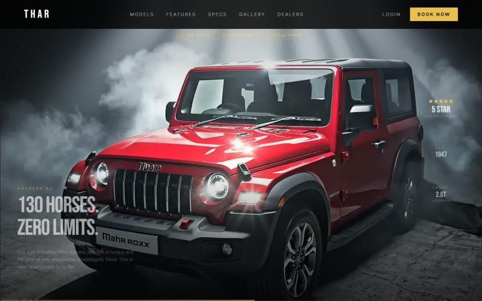
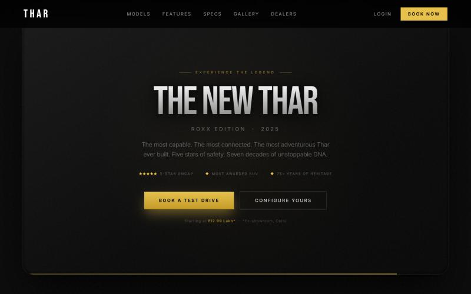
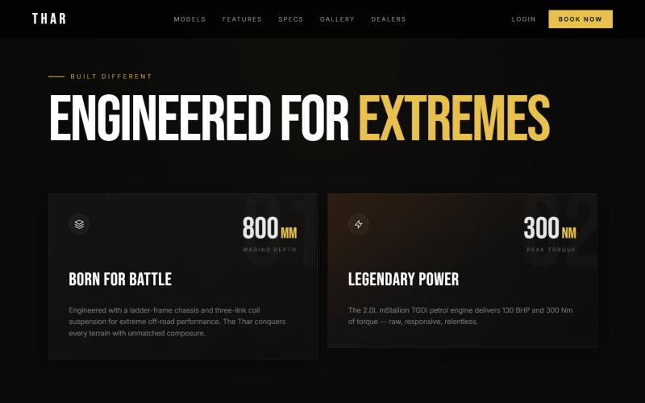
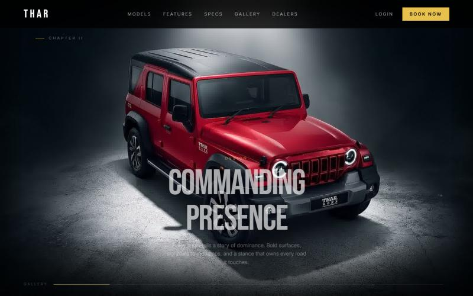
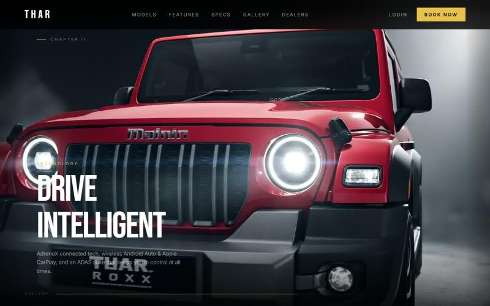
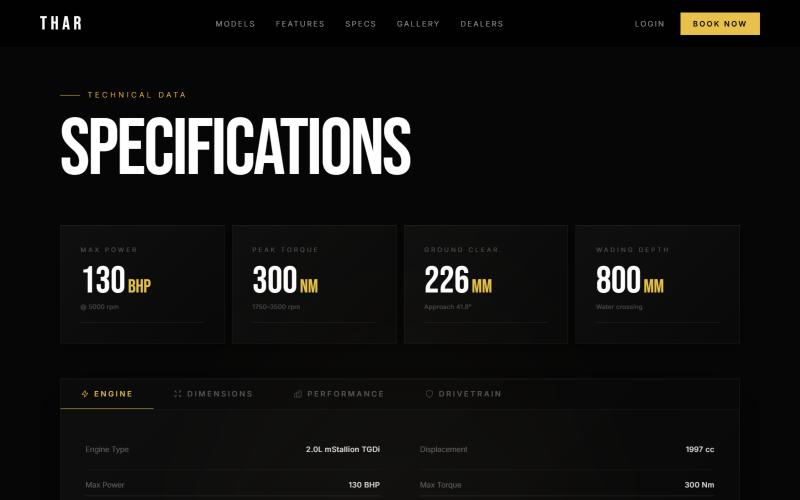

<div align="center">

<a href="https://thor-car-ad.vercel.app"></a>

# Thor Car Ad: THAR scroll-driven 3D ad

**A cinematic, scroll-driven product ad for the Mahindra Thar Roxx: a 480-frame 3D car sequence that plays as you scroll.**

[](https://thor-car-ad.vercel.app)


### 🔗 Live: **[https://thor-car-ad.vercel.app](https://thor-car-ad.vercel.app)**

</div>

---

## 🎬 3D in motion

Scroll the live site to drive these sequences yourself. Here they are as loops:

<table>
  <tr>
    <td align="center" width="50%">
      <a href="https://thor-car-ad.vercel.app"></a>
      <br><b>Hero reveal</b><br><sub>240 frames scrubbed by GSAP ScrollTrigger: <i>A silhouette like no other → No road. No rules. → 130 horses. Zero limits.</i></sub>
    </td>
    <td align="center" width="50%">
      <a href="https://thor-car-ad.vercel.app#gallery"></a>
      <br><b>Gallery orbit</b><br><sub>240 frames on a sticky canvas, mapped to scroll progress with Framer Motion: <i>Design · Interior · Technology · Heritage</i></sub>
    </td>
  </tr>
</table>

> **How the "3D" works:** there's no WebGL. Each sequence is a set of pre-rendered 1920×1080 frames drawn onto a `<canvas>`, and your scroll position picks the frame. Details in **[How it works](docs/HOW-IT-WORKS.md)**.

---

## 📸 Screenshots

| | |
|---|---|
| <br><sub>Hero: *Born for THAR the impossible*</sub> | <br><sub>Chapter 01: the reveal</sub> |
| <br><sub>Chapter 03: 130 horses, zero limits</sub> | <br><sub>Call to action: *The New Thar*</sub> |
| <br><sub>Engineered for Extremes</sub> | <br><sub>Gallery: Commanding Presence</sub> |
| <br><sub>Gallery: Drive Intelligent</sub> | <br><sub>Specifications</sub> |

---

## ✨ What's inside

- **Pinned cinematic hero**: a 7,000 px GSAP ScrollTrigger timeline. The headline fades, a card rises and expands to full screen, then three chapters scrub through the 240-frame reveal with stat badges, ending in a CTA.
- **Gallery orbit**: a 600vh sticky canvas with four scroll-timed text overlays and a progress bar.
- **Smooth inertial scrolling** with Lenis, driven by GSAP's ticker, so the scroll position, scrubs and canvas draws stay in sync.
- **Features, marquee and tabbed specs**, plus Book a Test Drive, Configure and Login modals with toasts. Everything runs in the page; no data is sent anywhere.
- **Tuned for integrated GPUs**: about 57 fps through the hero on Intel UHD graphics, with no long frames (down from about 3.6 s of stutter). See **[How it was built](docs/HOW-IT-WAS-BUILT.md#5-making-scrolling-smooth)**.

## 📚 Docs

| Doc | What's in it |
|---|---|
| **[How it was built](docs/HOW-IT-WAS-BUILT.md)** | Template setup, porting from Vite to Next.js, bugs fixed, performance work, deploy |
| **[How it works](docs/HOW-IT-WORKS.md)** | Page structure, Lenis + GSAP clock, the pinned timeline, cover-fit canvas drawing, the gallery's scroll mapping |

## 🗂 What's in this repo

```text
assets/
  hero-frames/      240 × 1920×1080 JPEG frames: hero reveal sequence
  gallery-frames/   240 × 1920×1080 JPEG frames: gallery orbit sequence
  favicon.svg
  readme/           animated banner + GIF loops used in this README
screenshots/        desktop captures of each section (1280×800)
docs/               how it was built, how it works
```

This repo holds the **assets, screenshots and documentation** only. The site's source code is not included.

## 🧰 Stack

Next.js 16 (App Router) · React 19 · TypeScript · Tailwind CSS v4 · GSAP 3 + ScrollTrigger · Framer Motion 12 · Lenis · deployed on Vercel.

> This is an unofficial concept / portfolio ad. *Mahindra*, *Thar* and *Roxx* are trademarks of Mahindra & Mahindra Ltd. This project is not affiliated with or endorsed by Mahindra.
